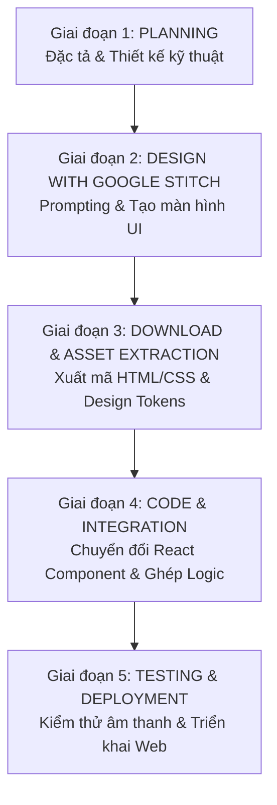

# VibeSpace — Project Execution Plan (PLAN.md)

---

## 1. Lộ trình triển khai tổng thể (Workflow Overview)

Kế hoạch thực thi dự án **VibeSpace** tuân thủ nghiêm ngặt theo chu trình 4 giai đoạn chuẩn hóa:

---

## 2. Chi tiết từng giai đoạn thực thi

### 📍 Giai đoạn 1: Planning & Requirements Specification (Hiện tại)
> **Mục tiêu:** Hoàn thiện toàn bộ tài liệu đặc tả sản phẩm (PRD), kiến trúc kỹ thuật (Tech Architecture), danh mục tài nguyên âm thanh/hình ảnh và bộ Prompt chuẩn cho Google Stitch.

- [x] Phân tích yêu cầu nghiệp vụ và trải nghiệm người dùng (Zero-login, Lofi + White noise mixer, Dynamic background, Center Pomodoro, Daily Reset Todo).
- [x] Soạn thảo tài liệu `PRD.md` chi tiết.
- [x] Xây dựng tài liệu `TECH_ARCHITECTURE.md` (chọn Vite + React + Zustand + Tailwind + Web Audio API).
- [x] Lập kế hoạch thực thi chi tiết `PLAN.md`.
- [ ] Soạn thảo bộ **Stitch Prompts Template** để chuẩn bị sinh giao diện ở Giai đoạn 2.

---

### 📍 Giai đoạn 2: Design with Google Stitch (UI/UX Generation)
> **Mục tiêu:** Sử dụng Google Stitch để thiết kế toàn bộ các trạng thái giao diện và components của VibeSpace theo phong cách Frosted Glassmorphism, tối giản, sang trọng và chuẩn công thái học thị giác.

---

#### 🔹 Task 2.1: Xây dựng Design System Tokens & Master Prompt Specification
- [ ] **Mô tả:** Thiết lập bộ Design Tokens chuẩn và soạn thảo khung Master Prompt cho Google Stitch dựa trên phong cách Frosted Glassmorphism (`backdrop-blur`, `bg-white/10`, viền `border-white/15`, màu nhấn Amber/Cyan, font Display thanh lịch).
- [ ] **Chi tiết thực hiện:**
  - Định nghĩa bảng màu (Dark nature theme: Slate 900 base, Frosted glass tint, Accent gold/amber cho Pomodoro focus, Cyan cho break).
  - Thiết lập quy tắc micro-motion và typography (Inter/Plus Jakarta Sans cho UI, JetBrains Mono hoặc Playfair/Space Grotesk cho số đồng hồ).
  - Soạn thảo tài liệu hướng dẫn prompt chuẩn (`STITCH_PROMPTS.md`) để áp dụng nhất quán cho các tác vụ tiếp theo.
- [ ] **Tiêu chí nghiệm thu (Acceptance Criteria):**
  - Có bộ prompt mẫu chuẩn hóa, mô tả chi tiết ngôn ngữ thị giác, sẵn sàng copy/sử dụng vào Google Stitch.

---

#### 🔹 Task 2.2: Thiết kế Screen 1 — Main Workspace & Floating Quick Dock
- [ ] **Mô tả:** Tạo màn hình làm việc chính (Default State) với không gian tĩnh lặng, cân bằng thị giác giữa nền thiên nhiên, đồng hồ trung tâm và thanh điều hướng nổi.
- [ ] **Chi tiết thành phần thiết kế:**
  - **Header:** Logo VibeSpace góc trái, đồng hồ thời gian thực (Live Clock) và nút cài đặt nhanh ở góc phải.
  - **Centerpiece Pomodoro:** Khối số đếm ngược cỡ lớn, vòng tiến độ tròn mờ (Circular Progress Ring), tag trạng thái (Focus / Short Break / Long Break), và các nút điều khiển nhỏ gọn (Play/Pause, Skip, Reset).
  - **Floating Quick Dock (Đáy màn hình):** Thanh dock kính mờ hình viên thuốc (pill shape) chứa 5 nút chức năng: Lofi Player, Ambient Soundboard, Daily Todo, Wallpaper Picker, Fullscreen/Zen Mode (có tooltip và active indicator).
- [ ] **Tiêu chí nghiệm thu (Acceptance Criteria):**
  - Layout trung tâm cân đối, số hiển thị rõ ràng trên mọi hình nền thiên nhiên (rừng mờ, biển đêm).
  - Quick Dock nổi tinh tế, không che khuất nội dung chính.

---

#### 🔹 Task 2.3: Thiết kế Screen 2 — Ambient Soundboard Drawer (Mixer âm thanh)
- [ ] **Mô tả:** Tạo bảng điều khiển mixer hòa âm tiếng ồn trắng dạng drawer trượt từ cạnh phải (hoặc modal kính mờ).
- [ ] **Chi tiết thành phần thiết kế:**
  - **Thanh Master Controls:** Thanh trượt âm lượng tổng (Master Volume), nút Quick Mute toàn bộ.
  - **Lưới Sound Cards (8–10 tracks):** Tiếng mưa (Rain), Sấm sét (Thunder), Lửa trại (Campfire), Gió rừng (Forest Wind), Sóng biển (Waves), Quán cà phê (Coffee Shop), Bàn phím cơ (Keyboard), Suối reo (Stream), Chim rừng (Birds), Tiếng ồn trắng (White Noise).
  - **Mỗi Sound Item:** Icon đại diện sắc nét, tên âm thanh, nút bật/tắt (Toggle) và thanh trượt âm lượng riêng biệt.
  - **Sound Presets Bar:** Hàng nút chọn nhanh các combo phối sẵn (ví dụ: *Đêm mưa trên núi*, *Quán quen chiều thu*, *Ven biển hoàng hôn*).
- [ ] **Tiêu chí nghiệm thu (Acceptance Criteria):**
  - Trạng thái Active/Inactive của từng âm thanh có sự phân biệt thị giác rõ rệt (sáng viền / glow nhẹ).
  - Bảng mixer cuộn mượt mà, thanh trượt volume kéo thả trực quan.

---

#### 🔹 Task 2.4: Thiết kế Screen 3 — Lofi Music Mini-Player (Trình phát nhạc YouTube)
- [ ] **Mô tả:** Tạo widget mini-player phát nhạc Lofi YouTube nhỏ gọn đặt ở góc màn hình hoặc popup nổi từ Quick Dock.
- [ ] **Chi tiết thành phần thiết kế:**
  - **Track Info Card:** Thumbnail video thu nhỏ, tên bài hát/livestream, visualizer sóng nhạc động giả lập.
  - **Custom Source Input:** Ô nhập/dán URL YouTube kèm nút "Play" và thanh gợi ý kênh nhạc Lofi thịnh hành (Lofi Girl, ChillHop, Synthwave, Jazz Coffee).
  - **Controls:** Play/Pause, Next track, Slider volume độc lập, nút Quick Mute.
- [ ] **Tiêu chí nghiệm thu (Acceptance Criteria):**
  - Widget gọn gàng, kích thước tối ưu, không làm rối không gian làm việc chính.
  - Hiển thị rõ ràng trạng thái đang phát (Playing) với hiệu ứng sóng âm (Wave animation).

---

#### 🔹 Task 2.5: Thiết kế Screen 4 — Daily Reset Todo List Drawer (Danh sách việc cần làm)
- [ ] **Mô tả:** Tạo bảng quản lý công việc hàng ngày dạng drawer trượt từ cạnh trái (hoặc popup nổi) với cơ chế tự làm mới mỗi ngày.
- [ ] **Chi tiết thành phần thiết kế:**
  - **Header & Progress:** Tiêu đề "Hôm nay", vòng hoặc thanh tiến độ hoàn thành (ví dụ: 3/5 task, 60%).
  - **Quick Add Input:** Ô nhập việc nhanh `+ Thêm công việc cần làm hôm nay... [Enter]`.
  - **Task List Items:** Checkbox tròn mờ tinh xảo, text gạch ngang mờ khi xong, badge tag "Daily Routine" (cho task lặp lại mỗi ngày), nút xóa task.
  - **Footer Notice:** Dòng text mờ chú thích: *"Danh sách sẽ tự động làm mới vào 00:00 hàng ngày"*.
  - **Empty State:** Minh họa nhẹ nhàng khi chưa có việc nào trong ngày.
- [ ] **Tiêu chí nghiệm thu (Acceptance Criteria):**
  - Checkbox và hiệu ứng hoàn thành task trực quan, thỏa mãn cảm giác hoàn thành (satisfying check effect).
  - Danh sách cuộn độc lập, không bị tràn màn hình khi có nhiều task.

---

#### 🔹 Task 2.6: Thiết kế Screen 5 — Wallpaper Selector Modal & Visual Dimmer
- [ ] **Mô tả:** Tạo popup modal duyệt kho hình nền thư giãn kèm bộ tinh chỉnh độ mờ (Blur) và độ tối (Dimmer).
- [ ] **Chi tiết thành phần thiết kế:**
  - **Category Tabs:** Rừng thông (Forest), Đại dương (Ocean), Núi tuyết (Mountains), Vũ trụ (Galaxy), Ấm cúng (Cozy Room), Tối giản (Minimal Gradients).
  - **Wallpaper Grid:** Lưới thumbnails tỷ lệ 16:9 chất lượng cao, có viền sáng (Active ring) đánh dấu hình nền đang được chọn.
  - **Visual Tuning Controls:**
    - Slider điều chỉnh độ tối màn hình (Overlay Dimmer: 0% – 80%).
    - Slider làm mờ hình nền (Background Blur: 0 – 20px).
    - Nút "Đổi ngẫu nhiên" (Shuffle Wallpaper).
- [ ] **Tiêu chí nghiệm thu (Acceptance Criteria):**
  - Thao tác xem trước (Preview) nhanh chóng, người dùng dễ dàng cảm nhận hiệu ứng mờ/tối qua thanh trượt.

---

#### 🔹 Task 2.7: Thiết kế Screen 6 — Zen Mode View & Responsive States
- [ ] **Mô tả:** Tạo thiết kế cho chế độ tập trung cực đại (Zen Mode) và các trạng thái thích ứng màn hình khác nhau.
- [ ] **Chi tiết thành phần thiết kế:**
  - **Zen Mode Layout:** Tự động ẩn hoàn toàn Header, Quick Dock, Todo và Drawer; chỉ giữ lại đồng hồ Pomodoro siêu tối giản và hình nền chuyển động nhẹ.
  - **Gợi ý thoát chế độ:** Tooltip hoặc text mờ góc dưới: *"Nhấn phím [ESC] hoặc [Z] để thoát chế độ Zen"*.
  - **Responsive Breakpoints:** Thiết kế tương thích cho Desktop chuẩn (1920×1080), Màn hình nhỏ / Laptop (1366×768), và Tablet ngang.
- [ ] **Tiêu chí nghiệm thu (Acceptance Criteria):**
  - Mang lại cảm giác thanh tĩnh, loại bỏ 100% các yếu tố gây xao nhãng.
  - Bố cục responsive không bị vỡ layout trên laptop 13-14 inch.

---

#### 🔹 Task 2.8: Tổng hợp, Kiểm tra tính nhất quán & Đóng gói Design System
- [ ] **Mô tả:** Rà soát lại toàn bộ 6 màn hình / components đã tạo trên Google Stitch để đảm bảo tính đồng bộ hoàn hảo trước khi tải mã nguồn.
- [ ] **Chi tiết thực hiện:**
  - Kiểm tra độ nhất quán: Cùng kích thước bo góc (`rounded-2xl` / `rounded-3xl`), cùng thông số lớp phủ kính (`backdrop-blur-md`, viền `border-white/10`), cùng hệ font chữ và icon style.
  - Tổng hợp danh sách URL và mã nguồn HTML/CSS của các màn hình đã được duyệt trên Stitch.
- [ ] **Tiêu chí nghiệm thu (Acceptance Criteria):**
  - Toàn bộ 6 màn hình đạt tiêu chuẩn thẩm mỹ, thống nhất phong cách Frosted Glassmorphism, sẵn sàng chuyển sang Giai đoạn 3 (Download & Asset Extraction).

---

### 📍 Giai đoạn 3: Download Design từ Stitch & Trích xuất Asset
> **Mục tiêu:** Tải mã nguồn thiết kế (HTML/CSS) từ Google Stitch về dự án, phân tích bảng mã màu, font chữ và xuất tài liệu `DESIGN.md`.

- [ ] Tải về các file HTML/CSS được sinh từ Stitch.
- [ ] Sử dụng skill trích xuất Design System (`stitch-extract-design-md`) để tổng hợp các tokens:
  - Bảng màu (Color Palette: Primary, Glass tint, Accent amber/cyan).
  - Định nghĩa độ mờ kính (`backdrop-blur-md`, `bg-white/10`, `border-white/20`).
  - Font typography và kích thước (Display fonts cho Pomodoro, Body fonts cho Todo).
- [ ] Chuẩn bị kho file âm thanh miễn phí bản quyền (Royalty-free) đặt vào thư mục `public/sounds/`:
  - Rain, Campfire, Forest Wind, Waves, Coffee Shop, Mechanical Keyboard, Chime sound.
- [ ] Chuẩn bị bộ ảnh nền mẫu chất lượng cao (WebP) đặt vào thư mục `public/wallpapers/`.

---

### 📍 Giai đoạn 4: Code — Chuyển đổi Design sang React Component
> **Mục tiêu:** Khởi tạo dự án React + Vite, chuyển đổi mã nguồn Stitch thành các React components module hóa và gắn kết logic Zustand store.

#### Sprint 4.1: Khởi tạo dự án & Cấu hình nền tảng
- [ ] Khởi tạo project React + TypeScript với Vite: `npm create vite@latest . -- --template react-ts`.
- [ ] Cài đặt các thư viện phụ thuộc:
  - UI & Icons: `tailwindcss`, `postcss`, `autoprefixer`, `lucide-react`, `clsx`, `tailwind-merge`, `framer-motion`.
  - State & Audio: `zustand`, `howler` (hoặc custom Web Audio hook), `react-youtube`.
- [ ] Cấu hình Tailwind CSS với các token lấy từ Stitch.

#### Sprint 4.2: Chuyển đổi & Xây dựng các UI Components (Dựa trên Stitch Design)
- [ ] `WallpaperViewer.tsx` & `DimmerOverlay.tsx`: Render nền động và lớp phủ làm mờ/tối.
- [ ] `PomodoroClock.tsx`: Chuyển đổi thiết kế đồng hồ trung tâm, hiển thị thời gian, nút Play/Pause/Reset.
- [ ] `SoundboardDrawer.tsx` & `SoundTrackItem.tsx`: Lưới mixer âm thanh với slider volume.
- [ ] `YoutubePlayer.tsx`: Trình phát lofi nhúng IFrame YouTube, hỗ trợ paste URL và chỉnh volume.
- [ ] `TodoDrawer.tsx` & `TodoItem.tsx`: Danh sách công việc với hiệu ứng hoàn thành.
- [ ] `QuickDock.tsx`: Thanh điều hướng nổi dưới đáy màn hình để bật/tắt các drawer.

#### Sprint 4.3: Tích hợp Business Logic & State Stores (Zustand)
- [ ] Cài đặt `usePomodoroStore`: Logic đếm ngược chính xác, chuyển phiên (Focus -> Break), phát âm thanh chime khi hết giờ.
- [ ] Cài đặt `useMixerStore`: Logic phát đa luồng âm thanh lặp (looping), volume riêng lẻ, master volume, lưu cấu hình vào `localStorage`.
- [ ] Cài đặt `useYoutubeStore`: Tích hợp YouTube Player API, tự động tải stream mặc định, hỗ trợ đổi video ID từ link dán vào.
- [ ] Cài đặt `useTodoStore`: Quản lý thêm/xóa/sửa task, gắn nhãn task hàng ngày, lưu trữ `localStorage`.
- [ ] Cài đặt hook `useDailyReset`: Thuật toán tự động reset task khi chuyển sang ngày mới (0h00 hoặc khi mở lại trình duyệt).
- [ ] Cài đặt Zen Mode toggle & Phím tắt tiện ích (`Z` cho Zen Mode, `Space` cho Play/Pause timer, `F` cho Fullscreen).

---

### 📍 Giai đoạn 5: Testing, Hoàn thiện & Triển khai (QA & Launch)
> **Mục tiêu:** Kiểm thử toàn diện trên nhiều trình duyệt, tối ưu hiệu năng và đóng gói ứng dụng.

- [ ] Kiểm thử chính sách Autoplay của trình duyệt (Browser Autoplay Policy).
- [ ] Kiểm thử cơ chế Daily Reset Todo bằng cách thay đổi ngày giờ hệ thống.
- [ ] Kiểm thử hiệu năng khi mở tab nền trong thời gian dài (Memory leak & CPU test).
- [ ] Kiểm thử hiển thị trên các kích thước màn hình Desktop/Laptop/Tablet.
- [ ] Build sản phẩm `npm run build` và hướng dẫn deploy lên Vercel / Netlify / GitHub Pages.

---

## 3. Quản lý rủi ro & Phương án dự phòng (Risk Management)

| Rủi ro kỹ thuật | Mức độ | Biện pháp xử lý dự phòng |
| :--- | :---: | :--- |
| **YouTube Autoplay bị chặn** do chính sách trình duyệt khi chưa có user click | Trung bình | Hiển thị nút "Bắt đầu tập trung (Start Vibe)" để người dùng kích hoạt phiên tương tác đầu tiên, mở khóa audio context. |
| **Video YouTube bị lỗi bản quyền hoặc bị xóa** khi người dùng dán link | Thấp | Bắt sự kiện error của YouTube IFrame API và tự động fallback về luồng Lofi mặc định của hệ thống kèm thông báo nhẹ (toast). |
| **Trình duyệt bóp xung nhịp timer khi đổi tab** (Background throttling) | Cao | Tính toán thời gian dựa trên `targetTimestamp = Date.now() + remainingMs` thay vì đếm `count - 1` mỗi giây của `setInterval`. |
| **Dung lượng file âm thanh white noise quá nặng** gây tải chậm | Trung bình | Sử dụng các đoạn audio loop ngắn (10-30s) nén chuẩn Ogg/WebM với bitrate tối ưu (~96kbps) có cross-fade mượt. |

---

## 4. Bước tiếp theo đề xuất (Next Immediate Step)

1. **Phê duyệt PRD và Kiến trúc:** Bạn xem xét bộ tài liệu `PRD.md`, `TECH_ARCHITECTURE.md`, `PLAN.md`.
2. **Tiến hành Giai đoạn 2 (Design với Google Stitch):** Chúng ta sẽ tạo bộ prompt chuẩn hóa chi tiết cho Google Stitch để bắt đầu sinh giao diện các màn hình của VibeSpace.

