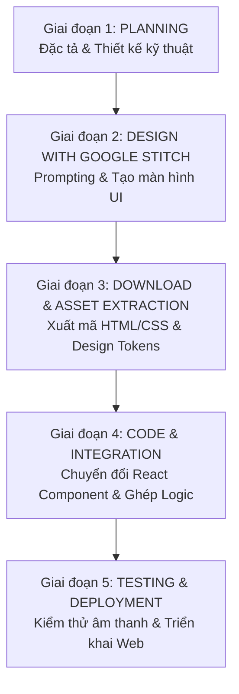

# VibeSpace — Project Execution Plan (PLAN.md)

---

## 1. Lộ trình triển khai tổng thể (Workflow Overview)

Kế hoạch thực thi dự án **VibeSpace** tuân thủ nghiêm ngặt theo chu trình 4 giai đoạn chuẩn hóa:

---

## 2. Chi tiết từng giai đoạn thực thi

### 📍 Giai đoạn 1: Planning & Requirements Specification (Hiện tại)
> **Mục tiêu:** Hoàn thiện toàn bộ tài liệu đặc tả sản phẩm (PRD), kiến trúc kỹ thuật (Tech Architecture), danh mục tài nguyên âm thanh/hình ảnh và bộ Prompt chuẩn cho Google Stitch.

- [x] Phân tích yêu cầu nghiệp vụ và trải nghiệm người dùng (Zero-login, Lofi + White noise mixer, Dynamic background, Center Pomodoro, Daily Reset Todo).
- [x] Soạn thảo tài liệu `PRD.md` chi tiết.
- [x] Xây dựng tài liệu `TECH_ARCHITECTURE.md` (chọn Vite + React + Zustand + Tailwind + Web Audio API).
- [x] Lập kế hoạch thực thi chi tiết `PLAN.md`.
- [ ] Soạn thảo bộ **Stitch Prompts Template** để chuẩn bị sinh giao diện ở Giai đoạn 2.

---

### 📍 Giai đoạn 2: Design with Google Stitch (UI/UX Generation)
> **Mục tiêu:** Sử dụng Google Stitch để thiết kế toàn bộ các trạng thái giao diện của VibeSpace theo phong cách Frosted Glassmorphism, tối giản và thẩm mỹ.

#### Các màn hình / Components cần thiết kế trên Stitch:
1. **Screen 1: Main Workspace (Màn hình chính mặc định):**
   - Hình nền thiên nhiên (Rừng thông sương mù / Hoàng hôn biển).
   - Khối đồng hồ Pomodoro trung tâm với font số to, circular progress ring mờ tinh xảo.
   - Thanh dock nổi bên dưới (Quick Dock) chứa các icon: Lofi Player, Soundboard Mixer, Todo List, Background Picker, Fullscreen/Zen Mode.
   - Thanh Header mờ góc trên: Logo VibeSpace, thời gian thực và nút cài đặt nhanh.
2. **Screen 2: Ambient Soundboard Drawer (Ngăn kéo Mixer âm thanh):**
   - Bảng điều khiển kính mờ trượt từ cạnh phải hoặc popup trung tâm.
   - Lưới 8-10 nút icon âm thanh (Mưa, Sấm, Gió, Lửa, Sóng biển, Phím gõ...) với thanh trượt volume riêng.
   - Master volume slider và hàng nút chọn Sound Presets (Rainy Night, Coffee Break...).
3. **Screen 3: Lofi Music Mini-Player (Trình phát nhạc Lofi):**
   - Khung điều khiển nhỏ gọn: Trạng thái bài hát, sóng nhạc lofi, thanh gõ URL YouTube và volume.
4. **Screen 4: Daily Todo List Drawer (Danh sách việc cần làm theo ngày):**
   - Panel danh sách công việc, thanh tiến độ (Progress bar).
   - Checkbox thẩm mỹ, nút thêm nhanh task, tag đánh dấu "Daily Routine".
5. **Screen 5: Background Selector Modal (Kho hình nền):**
   - Lưới chọn hình nền với các tab chủ đề: Rừng, Biển, Núi, Trời sao, Tối giản.
   - Thanh trượt chỉnh độ tối (Dimmer) và độ mờ (Blur) của nền.
6. **Screen 6: Zen Mode View (Chế độ tập trung tối thượng):**
   - Mọi thanh công cụ được ẩn hoàn toàn, chỉ giữ lại Pomodoro mờ nhẹ và background.

---

### 📍 Giai đoạn 3: Download Design từ Stitch & Trích xuất Asset
> **Mục tiêu:** Tải mã nguồn thiết kế (HTML/CSS) từ Google Stitch về dự án, phân tích bảng mã màu, font chữ và xuất tài liệu `DESIGN.md`.

- [ ] Tải về các file HTML/CSS được sinh từ Stitch.
- [ ] Sử dụng skill trích xuất Design System (`stitch-extract-design-md`) để tổng hợp các tokens:
  - Bảng màu (Color Palette: Primary, Glass tint, Accent amber/cyan).
  - Định nghĩa độ mờ kính (`backdrop-blur-md`, `bg-white/10`, `border-white/20`).
  - Font typography và kích thước (Display fonts cho Pomodoro, Body fonts cho Todo).
- [ ] Chuẩn bị kho file âm thanh miễn phí bản quyền (Royalty-free) đặt vào thư mục `public/sounds/`:
  - Rain, Campfire, Forest Wind, Waves, Coffee Shop, Mechanical Keyboard, Chime sound.
- [ ] Chuẩn bị bộ ảnh nền mẫu chất lượng cao (WebP) đặt vào thư mục `public/wallpapers/`.

---

### 📍 Giai đoạn 4: Code — Chuyển đổi Design sang React Component
> **Mục tiêu:** Khởi tạo dự án React + Vite, chuyển đổi mã nguồn Stitch thành các React components module hóa và gắn kết logic Zustand store.

#### Sprint 4.1: Khởi tạo dự án & Cấu hình nền tảng
- [ ] Khởi tạo project React + TypeScript với Vite: `npm create vite@latest . -- --template react-ts`.
- [ ] Cài đặt các thư viện phụ thuộc:
  - UI & Icons: `tailwindcss`, `postcss`, `autoprefixer`, `lucide-react`, `clsx`, `tailwind-merge`, `framer-motion`.
  - State & Audio: `zustand`, `howler` (hoặc custom Web Audio hook), `react-youtube`.
- [ ] Cấu hình Tailwind CSS với các token lấy từ Stitch.

#### Sprint 4.2: Chuyển đổi & Xây dựng các UI Components (Dựa trên Stitch Design)
- [ ] `WallpaperViewer.tsx` & `DimmerOverlay.tsx`: Render nền động và lớp phủ làm mờ/tối.
- [ ] `PomodoroClock.tsx`: Chuyển đổi thiết kế đồng hồ trung tâm, hiển thị thời gian, nút Play/Pause/Reset.
- [ ] `SoundboardDrawer.tsx` & `SoundTrackItem.tsx`: Lưới mixer âm thanh với slider volume.
- [ ] `YoutubePlayer.tsx`: Trình phát lofi nhúng IFrame YouTube, hỗ trợ paste URL và chỉnh volume.
- [ ] `TodoDrawer.tsx` & `TodoItem.tsx`: Danh sách công việc với hiệu ứng hoàn thành.
- [ ] `QuickDock.tsx`: Thanh điều hướng nổi dưới đáy màn hình để bật/tắt các drawer.

#### Sprint 4.3: Tích hợp Business Logic & State Stores (Zustand)
- [ ] Cài đặt `usePomodoroStore`: Logic đếm ngược chính xác, chuyển phiên (Focus -> Break), phát âm thanh chime khi hết giờ.
- [ ] Cài đặt `useMixerStore`: Logic phát đa luồng âm thanh lặp (looping), volume riêng lẻ, master volume, lưu cấu hình vào `localStorage`.
- [ ] Cài đặt `useYoutubeStore`: Tích hợp YouTube Player API, tự động tải stream mặc định, hỗ trợ đổi video ID từ link dán vào.
- [ ] Cài đặt `useTodoStore`: Quản lý thêm/xóa/sửa task, gắn nhãn task hàng ngày, lưu trữ `localStorage`.
- [ ] Cài đặt hook `useDailyReset`: Thuật toán tự động reset task khi chuyển sang ngày mới (0h00 hoặc khi mở lại trình duyệt).
- [ ] Cài đặt Zen Mode toggle & Phím tắt tiện ích (`Z` cho Zen Mode, `Space` cho Play/Pause timer, `F` cho Fullscreen).

---

### 📍 Giai đoạn 5: Testing, Hoàn thiện & Triển khai (QA & Launch)
> **Mục tiêu:** Kiểm thử toàn diện trên nhiều trình duyệt, tối ưu hiệu năng và đóng gói ứng dụng.

- [ ] Kiểm thử chính sách Autoplay của trình duyệt (Browser Autoplay Policy).
- [ ] Kiểm thử cơ chế Daily Reset Todo bằng cách thay đổi ngày giờ hệ thống.
- [ ] Kiểm thử hiệu năng khi mở tab nền trong thời gian dài (Memory leak & CPU test).
- [ ] Kiểm thử hiển thị trên các kích thước màn hình Desktop/Laptop/Tablet.
- [ ] Build sản phẩm `npm run build` và hướng dẫn deploy lên Vercel / Netlify / GitHub Pages.

---

## 3. Quản lý rủi ro & Phương án dự phòng (Risk Management)

| Rủi ro kỹ thuật | Mức độ | Biện pháp xử lý dự phòng |
| :--- | :---: | :--- |
| **YouTube Autoplay bị chặn** do chính sách trình duyệt khi chưa có user click | Trung bình | Hiển thị nút "Bắt đầu tập trung (Start Vibe)" để người dùng kích hoạt phiên tương tác đầu tiên, mở khóa audio context. |
| **Video YouTube bị lỗi bản quyền hoặc bị xóa** khi người dùng dán link | Thấp | Bắt sự kiện error của YouTube IFrame API và tự động fallback về luồng Lofi mặc định của hệ thống kèm thông báo nhẹ (toast). |
| **Trình duyệt bóp xung nhịp timer khi đổi tab** (Background throttling) | Cao | Tính toán thời gian dựa trên `targetTimestamp = Date.now() + remainingMs` thay vì đếm `count - 1` mỗi giây của `setInterval`. |
| **Dung lượng file âm thanh white noise quá nặng** gây tải chậm | Trung bình | Sử dụng các đoạn audio loop ngắn (10-30s) nén chuẩn Ogg/WebM với bitrate tối ưu (~96kbps) có cross-fade mượt. |

---

## 4. Bước tiếp theo đề xuất (Next Immediate Step)

1. **Phê duyệt PRD và Kiến trúc:** Bạn xem xét bộ tài liệu `PRD.md`, `TECH_ARCHITECTURE.md`, `PLAN.md`.
2. **Tiến hành Giai đoạn 2 (Design với Google Stitch):** Chúng ta sẽ tạo bộ prompt chuẩn hóa chi tiết cho Google Stitch để bắt đầu sinh giao diện các màn hình của VibeSpace.

