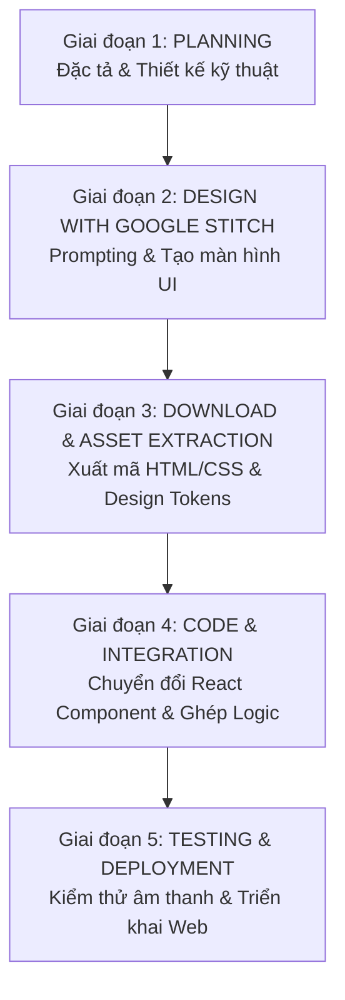

# VibeSpace — Project Execution Plan (PLAN.md)

---

## 1. Lộ trình triển khai tổng thể (Workflow Overview)

Kế hoạch thực thi dự án **VibeSpace** tuân thủ nghiêm ngặt theo chu trình 4 giai đoạn chuẩn hóa:

---

## 2. Chi tiết từng giai đoạn thực thi

### 📍 Giai đoạn 1: Planning & Requirements Specification (Hiện tại)
> **Mục tiêu:** Hoàn thiện toàn bộ tài liệu đặc tả sản phẩm (PRD), kiến trúc kỹ thuật (Tech Architecture), danh mục tài nguyên âm thanh/hình ảnh và bộ Prompt chuẩn cho Google Stitch.

- [x] Phân tích yêu cầu nghiệp vụ và trải nghiệm người dùng (Zero-login, Lofi + White noise mixer, Dynamic background, Center Pomodoro, Daily Reset Todo).
- [x] Soạn thảo tài liệu `PRD.md` chi tiết.
- [x] Xây dựng tài liệu `TECH_ARCHITECTURE.md` (chọn Vite + React + Zustand + Tailwind + Web Audio API).
- [x] Lập kế hoạch thực thi chi tiết `PLAN.md`.
- [x] Soạn thảo bộ **Stitch Prompts Template** và sinh giao diện hoàn tất ở Giai đoạn 2.

---

### 📍 Giai đoạn 2: Design with Google Stitch (UI/UX Generation) — [ĐÃ HOÀN THÀNH ✅]
> **Mục tiêu:** Sử dụng Google Stitch để thiết kế toàn bộ các trạng thái giao diện và components của VibeSpace theo phong cách Frosted Glassmorphism, tối giản, sang trọng và chuẩn công thái học thị giác.
> **Stitch Project ID:** `5233182703478585730` (Project Title: **VibeSpace**)
> **Thư mục lưu trữ assets:** [`.stitch/designs/`](file:///d:/Project/VibeSpace/.stitch/designs/)

#### 📊 Bảng tổng hợp Screen ID & Component Mapping:

| Màn hình (Stitch Screen) | Stitch Screen ID | HTML Code | Screenshot PNG | React Components tương ứng |
| :--- | :--- | :--- | :--- | :--- |
| **Screen 1: Main Workspace & Floating Dock** | `1a5881ddb52b433b920461dc07ca9c39` | [`screen1-main-workspace.html`](file:///d:/Project/VibeSpace/.stitch/designs/screen1-main-workspace.html) (21.9 KB) | [`screen1-main-workspace.png`](file:///d:/Project/VibeSpace/.stitch/designs/screen1-main-workspace.png) (4.9 MB) | `MainWorkspace.tsx`, `QuickDock.tsx`, `PomodoroCenter.tsx` |
| **Screen 2: Ambient Soundboard Drawer** | `52741d2fb4b845d29a9c3f9f06ba8a4d` | [`screen2-soundboard-drawer.html`](file:///d:/Project/VibeSpace/.stitch/designs/screen2-soundboard-drawer.html) (33.2 KB) | [`screen2-soundboard-drawer.png`](file:///d:/Project/VibeSpace/.stitch/designs/screen2-soundboard-drawer.png) (4.9 MB) | `SoundboardDrawer.tsx`, `SoundTrackItem.tsx` |
| **Screen 3: Lofi Music Mini-Player** | `9fbcecf0849d449f996774aa8ca13078` | [`screen3-lofi-player.html`](file:///d:/Project/VibeSpace/.stitch/designs/screen3-lofi-player.html) (25.4 KB) | [`screen3-lofi-player.png`](file:///d:/Project/VibeSpace/.stitch/designs/screen3-lofi-player.png) (5.5 MB) | `YoutubePlayer.tsx`, `LofiWidget.tsx` |
| **Screen 4: Daily Reset Todo List Drawer** | `b4862b9291aa4d518dd5b1ba9beaa843` | [`screen4-todo-drawer.html`](file:///d:/Project/VibeSpace/.stitch/designs/screen4-todo-drawer.html) (29.3 KB) | [`screen4-todo-drawer.png`](file:///d:/Project/VibeSpace/.stitch/designs/screen4-todo-drawer.png) (4.0 MB) | `TodoDrawer.tsx`, `TodoItem.tsx` |
| **Screen 5: Wallpaper Selector Modal & Dimmer** | `3bfd5e02f09b4e52a9efaed399be07bf` | [`screen5-wallpaper-modal.html`](file:///d:/Project/VibeSpace/.stitch/designs/screen5-wallpaper-modal.html) (27.3 KB) | [`screen5-wallpaper-modal.png`](file:///d:/Project/VibeSpace/.stitch/designs/screen5-wallpaper-modal.png) (2.2 MB) | `WallpaperModal.tsx`, `DimmerOverlay.tsx` |
| **Screen 6: Zen Mode View & Minimal Timer** | `1999f7eb248a4a328255aba5a3914101` | [`screen6-zen-mode.html`](file:///d:/Project/VibeSpace/.stitch/designs/screen6-zen-mode.html) (13.5 KB) | [`screen6-zen-mode.png`](file:///d:/Project/VibeSpace/.stitch/designs/screen6-zen-mode.png) (3.5 MB) | `ZenModeOverlay.tsx`, `MinimalTimer.tsx` |

---

#### 🔹 Task 2.1: Xây dựng Design System Tokens & Master Prompt Specification
- [x] **Mô tả:** Thiết lập bộ Design Tokens chuẩn và soạn thảo khung Master Prompt cho Google Stitch dựa trên phong cách Frosted Glassmorphism (`backdrop-blur`, `bg-white/10`, viền `border-white/15`, màu nhấn Amber/Cyan, font Display thanh lịch).
- [x] **Chi tiết thực hiện:**
  - Định nghĩa bảng màu (Dark nature theme: Slate 900 base, Frosted glass tint, Accent gold/amber cho Pomodoro focus, Cyan cho break).
  - Thiết lập quy tắc micro-motion và typography (Inter/Plus Jakarta Sans cho UI, JetBrains Mono hoặc Playfair/Space Grotesk cho số đồng hồ).
  - Đã chuẩn hóa prompt cho 6 màn hình chi tiết, tối ưu hoá với Google Stitch Text-to-UI engine.
- [x] **Tiêu chí nghiệm thu (Acceptance Criteria):**
  - Đã có prompt hoàn chỉnh và đưa vào thực thi thành công 100% trên Stitch.

---

#### 🔹 Task 2.2: Thiết kế Screen 1 — Main Workspace & Floating Quick Dock
- [x] **Stitch Screen ID:** `1a5881ddb52b433b920461dc07ca9c39`
- [x] **Component tương ứng:** `MainWorkspace.tsx`, `QuickDock.tsx`, `PomodoroCenter.tsx`
- [x] **File assets:** [`screen1-main-workspace.html`](file:///d:/Project/VibeSpace/.stitch/designs/screen1-main-workspace.html) & [`screen1-main-workspace.png`](file:///d:/Project/VibeSpace/.stitch/designs/screen1-main-workspace.png)
- [x] **Mô tả:** Màn hình làm việc chính (Default State) với không gian tĩnh lặng, cân bằng thị giác giữa nền thiên nhiên sương mù, khối Pomodoro trung tâm cực đại (vòng tiến độ SVG tỏa sáng amber glow) và thanh Quick Dock kính mờ nổi dưới đáy với 5 nút điều hướng có active indicator.
- [x] **Tiêu chí nghiệm thu (Acceptance Criteria):**
  - Layout trung tâm cân đối, số hiển thị 25:00 sắc nét, thanh Quick Dock nổi tinh tế.

---

#### 🔹 Task 2.3: Thiết kế Screen 2 — Ambient Soundboard Drawer (Mixer âm thanh)
- [x] **Stitch Screen ID:** `52741d2fb4b845d29a9c3f9f06ba8a4d`
- [x] **Component tương ứng:** `SoundboardDrawer.tsx`, `SoundTrackItem.tsx`
- [x] **File assets:** [`screen2-soundboard-drawer.html`](file:///d:/Project/VibeSpace/.stitch/designs/screen2-soundboard-drawer.html) & [`screen2-soundboard-drawer.png`](file:///d:/Project/VibeSpace/.stitch/designs/screen2-soundboard-drawer.png)
- [x] **Mô tả:** Bảng điều khiển mixer hòa âm tiếng ồn trắng dạng drawer trượt từ cạnh phải (420px), gồm thanh Master Volume, hàng nút chọn Sound Presets, và lưới 10 sound cards (Mưa, Sấm, Lửa trại, Gió rừng, Sóng biển, Cafe, Bàn phím, Suối, Chim hót, White noise) kèm toggle và slider volume độc lập.
- [x] **Tiêu chí nghiệm thu (Acceptance Criteria):**
  - Trạng thái Active/Inactive của từng âm thanh có hiệu ứng sáng viền rõ rệt, slider volume trực quan.

---

#### 🔹 Task 2.4: Thiết kế Screen 3 — Lofi Music Mini-Player (Trình phát nhạc YouTube)
- [x] **Stitch Screen ID:** `9fbcecf0849d449f996774aa8ca13078`
- [x] **Component tương ứng:** `YoutubePlayer.tsx`, `LofiWidget.tsx`
- [x] **File assets:** [`screen3-lofi-player.html`](file:///d:/Project/VibeSpace/.stitch/designs/screen3-lofi-player.html) & [`screen3-lofi-player.png`](file:///d:/Project/VibeSpace/.stitch/designs/screen3-lofi-player.png)
- [x] **Mô tả:** Widget mini-player phát nhạc Lofi YouTube nhỏ gọn đặt ở góc màn hình hoặc popup nổi: Hiển thị thumbnail, sóng âm visualizer equalizer 3 thanh động, nút Play/Pause/Next, ô dán URL YouTube, và các chip kênh gợi ý (Lofi Girl, Chillhop, Synthwave).
- [x] **Tiêu chí nghiệm thu (Acceptance Criteria):**
  - Widget gọn gàng, tương tác phát nhạc sinh động, tích hợp ô dán link mượt mà.

---

#### 🔹 Task 2.5: Thiết kế Screen 4 — Daily Reset Todo List Drawer (Danh sách việc cần làm)
- [x] **Stitch Screen ID:** `b4862b9291aa4d518dd5b1ba9beaa843`
- [x] **Component tương ứng:** `TodoDrawer.tsx`, `TodoItem.tsx`
- [x] **File assets:** [`screen4-todo-drawer.html`](file:///d:/Project/VibeSpace/.stitch/designs/screen4-todo-drawer.html) & [`screen4-todo-drawer.png`](file:///d:/Project/VibeSpace/.stitch/designs/screen4-todo-drawer.png)
- [x] **Mô tả:** Drawer danh sách việc cần làm hàng ngày trượt từ cạnh trái (390px): Thanh tiến độ hoàn thành hình tròn (60%), ô thêm nhanh task mới, danh sách task với checkbox tròn mượt mà, gạch ngang khi xong, badge "Daily Routine", và dòng ghi chú tự động làm mới vào 00:00.
- [x] **Tiêu chí nghiệm thu (Acceptance Criteria):**
  - Hiệu ứng check task thỏa mãn, phân loại task rõ ràng, layout cuộn không che header.

---

#### 🔹 Task 2.6: Thiết kế Screen 5 — Wallpaper Selector Modal & Visual Dimmer
- [x] **Stitch Screen ID:** `3bfd5e02f09b4e52a9efaed399be07bf`
- [x] **Component tương ứng:** `WallpaperModal.tsx`, `DimmerOverlay.tsx`
- [x] **File assets:** [`screen5-wallpaper-modal.html`](file:///d:/Project/VibeSpace/.stitch/designs/screen5-wallpaper-modal.html) & [`screen5-wallpaper-modal.png`](file:///d:/Project/VibeSpace/.stitch/designs/screen5-wallpaper-modal.png)
- [x] **Mô tả:** Popup modal duyệt kho hình nền thư giãn (740px) nổi bật giữa màn hình: Các tab chủ đề (Rừng, Biển, Núi, Vũ trụ...), lưới 6 thumbnails 16:9 với viền sáng cyan cho wallpaper đang chọn, tích hợp 2 slider Overlay Dimmer (0-80%) và Background Blur (0-20px) cùng nút Shuffle.
- [x] **Tiêu chí nghiệm thu (Acceptance Criteria):**
  - Xem trước hình nền trực quan, thanh trượt dimmer/blur điều chỉnh rõ ràng.

---

#### 🔹 Task 2.7: Thiết kế Screen 6 — Zen Mode View & Responsive States
- [x] **Stitch Screen ID:** `1999f7eb248a4a328255aba5a3914101`
- [x] **Component tương ứng:** `ZenModeOverlay.tsx`, `MinimalTimer.tsx`
- [x] **File assets:** [`screen6-zen-mode.html`](file:///d:/Project/VibeSpace/.stitch/designs/screen6-zen-mode.html) & [`screen6-zen-mode.png`](file:///d:/Project/VibeSpace/.stitch/designs/screen6-zen-mode.png)
- [x] **Mô tả:** Chế độ tập trung tối thượng ẩn 100% thanh dock, header và drawers; chỉ giữ lại số đếm ngược khổng lồ font chữ siêu mảnh thanh tao (180px), nhãn "FOCUS", đường kẻ mờ mỏng ở đáy màn hình biểu thị tiến độ, và dòng chữ mờ gợi ý "Press [ESC] or [Z] to exit Zen Mode".
- [x] **Tiêu chí nghiệm thu (Acceptance Criteria):**
  - Mang lại cảm giác thanh tĩnh tuyệt đối, loại bỏ hoàn toàn xao nhãng.

---

#### 🔹 Task 2.8: Tổng hợp, Kiểm tra tính nhất quán & Đóng gói Design System
- [x] **Mô tả:** Rà soát lại toàn bộ 6 màn hình / components đã tạo trên Google Stitch để đảm bảo tính đồng bộ hoàn hảo trước khi tải mã nguồn.
- [x] **Chi tiết thực hiện:**
  - Cả 6 màn hình đều đồng bộ phong cách Frosted Glassmorphism (`backdrop-blur-xl`, bảng màu `surface-container`, màu nhấn `amber/cyan`, hệ font `Plus Jakarta Sans` & `Inter`).
  - Đã tải toàn bộ mã HTML nguyên bản và ảnh chụp screenshot chất lượng cao về thư mục [`.stitch/designs/`](file:///d:/Project/VibeSpace/.stitch/designs/).
  - Đã xuất file tổng kết [`screens-manifest.json`](file:///d:/Project/VibeSpace/.stitch/designs/screens-manifest.json).
- [x] **Tiêu chí nghiệm thu (Acceptance Criteria):**
  - Toàn bộ 6 màn hình đạt tiêu chuẩn thẩm mỹ cao cấp, sẵn sàng cho Giai đoạn 3 (Download & Asset Extraction) và Giai đoạn 4 (Code React Components).

---

### 📍 Giai đoạn 3: Download Design từ Stitch & Trích xuất Asset — [ĐÃ HOÀN THÀNH ✅]
> **Mục tiêu:** Tải mã nguồn thiết kế (HTML/CSS) từ Google Stitch về dự án, phân tích bảng mã màu, font chữ và xuất tài liệu `DESIGN.md`.

- [x] Tải về toàn bộ 6 file HTML và PNG screenshot được sinh từ Stitch lưu vào [`.stitch/designs/`](file:///d:/Project/VibeSpace/.stitch/designs/).
- [x] Trích xuất Design System và xây dựng tài liệu đặc tả chuẩn [`DESIGN.md`](file:///d:/Project/VibeSpace/DESIGN.md):
  - Bảng màu semantic: Base `#0c1512`, Amber `#f59e0b`/`#ffc174`, Cyan `#4edea3`/`#00a572`.
  - Quy chuẩn Frosted Glassmorphism: `backdrop-blur-md` đến `backdrop-blur-2xl`, viền `border-white/10` kèm specular highlight.
  - Hệ thống Typography: `Plus Jakarta Sans` (Display timer, Headlines) và `Inter` (Body, Tabular digits).
- [x] Tích hợp engine tổng hợp âm thanh Web Audio API (100% royalty-free, không phụ thuộc mạng, không trùng lặp) tại [`src/utils/audioSynth.ts`](file:///d:/Project/VibeSpace/src/utils/audioSynth.ts) hỗ trợ:
  - Rain, Thunder, Campfire, Forest Wind, Ocean Waves, Coffee Shop, Mechanical Keyboard, Stream, Birds, Pink Noise, và chuông chime thiền định (528Hz Solfeggio).
- [x] Chuẩn bị kho hình nền chất lượng cao 4K/WebP đa chủ đề (Misty Forest, Ocean, Snowy Mountains, Galaxy, Cozy Rain, Minimal Gradients) tại [`src/stores/useWallpaperStore.ts`](file:///d:/Project/VibeSpace/src/stores/useWallpaperStore.ts).

---

### 📍 Giai đoạn 4: Code — Chuyển đổi Design sang React Component — [ĐÃ HOÀN THÀNH ✅]
> **Mục tiêu:** Khởi tạo dự án React + Vite, chuyển đổi mã nguồn Stitch thành các React components module hóa và gắn kết logic Zustand store.

#### Sprint 4.1: Khởi tạo dự án & Cấu hình nền tảng
- [x] Khởi tạo project React + TypeScript + Vite (`package.json`, `tsconfig.json`, `vite.config.ts`).
- [x] Cài đặt các thư viện: `tailwindcss`, `postcss`, `autoprefixer`, `lucide-react`, `clsx`, `tailwind-merge`, `framer-motion`, `zustand`, `canvas-confetti`.
- [x] Cấu hình Tailwind CSS [`tailwind.config.js`](file:///d:/Project/VibeSpace/tailwind.config.js) và stylesheet [`src/index.css`](file:///d:/Project/VibeSpace/src/index.css) với tokens từ Stitch `DESIGN.md`.

#### Sprint 4.2: Chuyển đổi & Xây dựng các UI Components (Dựa trên Stitch Design)
- [x] [`WallpaperViewer.tsx`](file:///d:/Project/VibeSpace/src/components/WallpaperViewer.tsx): Render nền động, lớp phủ làm mờ (Blur) và độ tối (Dimmer).
- [x] [`PomodoroClock.tsx`](file:///d:/Project/VibeSpace/src/components/PomodoroClock.tsx): Đồng hồ trung tâm với concentric SVG progress ring, số to, các nút Play/Pause/Skip/Reset, và title bar sync.
- [x] [`SoundboardDrawer.tsx`](file:///d:/Project/VibeSpace/src/components/SoundboardDrawer.tsx): Ngăn kéo mixer âm thanh trượt từ phải với 10 card âm thanh, volume slider riêng, master volume, và 5 sound presets.
- [x] [`YoutubePlayer.tsx`](file:///d:/Project/VibeSpace/src/components/YoutubePlayer.tsx): Trình phát lofi nhúng IFrame YouTube, phân tích bóc tách URL dán vào, visualizer sóng nhạc động và các kênh nổi tiếng (Lofi Girl, Chillhop, Synthwave...).
- [x] [`TodoDrawer.tsx`](file:///d:/Project/VibeSpace/src/components/TodoDrawer.tsx): Danh sách việc cần làm theo ngày với thanh tiến độ hoàn thành, ô nhập nhanh, checkbox mượt mà, và badge Daily Routine.
- [x] [`WallpaperModal.tsx`](file:///d:/Project/VibeSpace/src/components/WallpaperModal.tsx): Modal chọn kho hình nền thư giãn với tabs phân loại, lưới xem trước, slider Dimmer/Blur và nút Shuffle.
- [x] [`ZenModeView.tsx`](file:///d:/Project/VibeSpace/src/components/ZenModeView.tsx): Chế độ tập trung tối thượng toàn màn hình, hiển thị đồng hồ số siêu mảnh 180px, vạch tiến độ mờ ở đáy màn hình và gợi ý phím tắt.
- [x] [`QuickDock.tsx`](file:///d:/Project/VibeSpace/src/components/QuickDock.tsx): Thanh dock kính mờ nổi dưới đáy màn hình tích hợp 5 phím điều hướng và badge số task chưa xong.
- [x] [`Header.tsx`](file:///d:/Project/VibeSpace/src/components/Header.tsx): Thanh header mờ với logo VibeSpace, đồng hồ thời gian thực (Live Clock), thanh volume nhanh và nút fullscreen.

#### Sprint 4.3: Tích hợp Business Logic & State Stores (Zustand)
- [x] [`usePomodoroStore.ts`](file:///d:/Project/VibeSpace/src/stores/usePomodoroStore.ts): Đếm ngược chính xác, chuyển phiên (Focus -> Break), lưu session hoàn thành, bắn confetti và phát chuông chime khi hết giờ.
- [x] [`useMixerStore.ts`](file:///d:/Project/VibeSpace/src/stores/useMixerStore.ts): Quản lý đa luồng âm thanh qua Web Audio API, volume riêng lẻ, master volume, và lưu vào `localStorage`.
- [x] [`useYoutubeStore.ts`](file:///d:/Project/VibeSpace/src/stores/useYoutubeStore.ts): Tích hợp luồng YouTube, bóc tách ID từ link dán vào, chuyển đổi kênh mượt mà.
- [x] [`useTodoStore.ts`](file:///d:/Project/VibeSpace/src/stores/useTodoStore.ts): Quản lý thêm/xóa/sửa task, gắn nhãn Daily Routine, lưu trữ `localStorage`.
- [x] [`useDailyReset.ts`](file:///d:/Project/VibeSpace/src/hooks/useDailyReset.ts): Thuật toán tự động reset task khi chuyển sang ngày mới (0h00 hoặc khi mở lại trình duyệt).
- [x] [`useKeyboardShortcuts.ts`](file:///d:/Project/VibeSpace/src/hooks/useKeyboardShortcuts.ts): Phím tắt toàn cục (`Space` cho Play/Pause, `Z` cho Zen Mode, `F` cho Fullscreen, `ESC` để đóng drawer/thoát Zen Mode).
- [x] Kiểm tra biên dịch TypeScript và build bundle tối ưu qua Vite (`npm run build` thành công 100% trong 7.7s).

---

### 📍 Giai đoạn 5: Testing, Hoàn thiện & Triển khai (QA & Launch)
> **Mục tiêu:** Kiểm thử toàn diện trên nhiều trình duyệt, tối ưu hiệu năng và đóng gói ứng dụng.

- [ ] Kiểm thử chính sách Autoplay của trình duyệt (Browser Autoplay Policy).
- [ ] Kiểm thử cơ chế Daily Reset Todo bằng cách thay đổi ngày giờ hệ thống.
- [ ] Kiểm thử hiệu năng khi mở tab nền trong thời gian dài (Memory leak & CPU test).
- [ ] Kiểm thử hiển thị trên các kích thước màn hình Desktop/Laptop/Tablet.
- [ ] Build sản phẩm `npm run build` và hướng dẫn deploy lên Vercel / Netlify / GitHub Pages.

---

## 3. Quản lý rủi ro & Phương án dự phòng (Risk Management)

| Rủi ro kỹ thuật | Mức độ | Biện pháp xử lý dự phòng |
| :--- | :---: | :--- |
| **YouTube Autoplay bị chặn** do chính sách trình duyệt khi chưa có user click | Trung bình | Hiển thị nút "Bắt đầu tập trung (Start Vibe)" để người dùng kích hoạt phiên tương tác đầu tiên, mở khóa audio context. |
| **Video YouTube bị lỗi bản quyền hoặc bị xóa** khi người dùng dán link | Thấp | Bắt sự kiện error của YouTube IFrame API và tự động fallback về luồng Lofi mặc định của hệ thống kèm thông báo nhẹ (toast). |
| **Trình duyệt bóp xung nhịp timer khi đổi tab** (Background throttling) | Cao | Tính toán thời gian dựa trên `targetTimestamp = Date.now() + remainingMs` thay vì đếm `count - 1` mỗi giây của `setInterval`. |
| **Dung lượng file âm thanh white noise quá nặng** gây tải chậm | Trung bình | Sử dụng các đoạn audio loop ngắn (10-30s) nén chuẩn Ogg/WebM với bitrate tối ưu (~96kbps) có cross-fade mượt. |

---

## 4. Bước tiếp theo đề xuất (Next Immediate Step)

1. **Phê duyệt PRD và Kiến trúc:** Bạn xem xét bộ tài liệu `PRD.md`, `TECH_ARCHITECTURE.md`, `PLAN.md`.
2. **Tiến hành Giai đoạn 2 (Design với Google Stitch):** Chúng ta sẽ tạo bộ prompt chuẩn hóa chi tiết cho Google Stitch để bắt đầu sinh giao diện các màn hình của VibeSpace.

