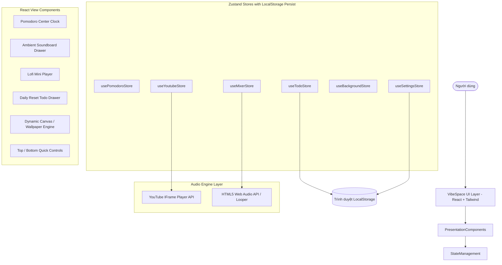
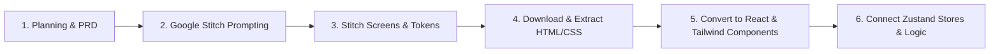

# VibeSpace — Technical Architecture Document

---

## 1. Tổng quan kiến trúc (Architectural Overview)

**VibeSpace** được thiết kế theo kiến trúc **Single Page Application (SPA) - Client-side Only / Local-First**. Ứng dụng không cần backend server phức tạp cho việc xác thực người dùng, toàn bộ logic tính toán, trạng thái giao diện và dữ liệu (Todo, âm lượng, cấu hình) được xử lý trực tiếp tại trình duyệt người dùng qua Web APIs và lưu trữ trong `localStorage`.



---

## 2. Lựa chọn công nghệ (Technology Stack)

| Thành phần | Công nghệ lựa chọn | Lý do lựa chọn & Lợi ích |
| :--- | :--- | :--- |
| **Build Tool & Bundler** | **Vite** | Tốc độ khởi động HMR cực nhanh, tối ưu hóa bundle nhỏ gọn cho ứng dụng client-side. |
| **Frontend Framework** | **React 18/19 (TypeScript)** | Hệ sinh thái hoàn thiện, tương thích tối đa với công cụ chuyển đổi component từ Google Stitch. TypeScript đảm bảo an toàn kiểu dữ liệu. |
| **Styling & Theme** | **Tailwind CSS + Tailwind Glassmorphism** | Xây dựng giao diện mờ kính (Frosted Glass), dễ dàng tùy biến theme và màu sắc tương phản cao trên nền động. |
| **Iconography & Motion** | **Lucide React + Framer Motion** | Bộ icon tối giản, hiện đại và thư viện animation giúp các thanh trượt âm thanh, popup drawer chuyển động mượt mà. |
| **State Management** | **Zustand** | Siêu nhẹ (~1KB), cú pháp đơn giản, không boilerplate như Redux, hỗ trợ sẵn middleware `persist` lưu trực tiếp vào `localStorage`. |
| **Ambient Audio Engine** | **Howler.js hoặc HTML5 Web Audio API** | Xử lý đa luồng âm thanh lặp (looping), kiểm soát gain (volume) độc lập từng kênh mà không lo rò rỉ bộ nhớ (memory leak). |
| **Music Streaming** | **YouTube IFrame API (`react-youtube`)** | Phát nhạc từ nguồn YouTube phong phú mà không cần vi phạm bản quyền hay host file nhạc nặng. |

---

## 3. Cấu trúc thư mục dự án (Project Directory Structure)

Cấu trúc thư mục được phân chia module rõ ràng nhằm đáp ứng quy trình chuyển đổi từ thiết kế Stitch sang React component:

```
VibeSpace/
├── public/
│   ├── sounds/                     # File âm thanh white noise (.mp3 / .ogg)
│   │   ├── rain.mp3
│   │   ├── campfire.mp3
│   │   ├── wind.mp3
│   │   ├── waves.mp3
│   │   ├── coffee-shop.mp3
│   │   └── chimes.mp3
│   └── wallpapers/                 # Ảnh/Video thumbnail chất lượng cao
├── src/
│   ├── assets/                     # Icons, static vectors
│   ├── components/
│   │   ├── common/                 # Component dùng chung (Button, Slider, Modal, Tooltip)
│   │   ├── pomodoro/               # Khối đồng hồ Pomodoro trung tâm
│   │   │   ├── PomodoroClock.tsx
│   │   │   ├── PomodoroControls.tsx
│   │   │   └── PomodoroSettingsModal.tsx
│   │   ├── audio/                  # Trình phát lofi & Mixer âm thanh
│   │   │   ├── YoutubePlayer.tsx
│   │   │   ├── SoundboardDrawer.tsx
│   │   │   ├── SoundTrackItem.tsx
│   │   │   └── PresetsBar.tsx
│   │   ├── todo/                   # Danh sách công việc theo ngày
│   │   │   ├── TodoDrawer.tsx
│   │   │   ├── TodoItem.tsx
│   │   │   └── TodoProgressBar.tsx
│   │   ├── background/             # Trình quản lý hình nền & dimmer
│   │   │   ├── WallpaperViewer.tsx
│   │   │   ├── WallpaperPickerModal.tsx
│   │   │   └── DimmerOverlay.tsx
│   │   └── layout/                 # Layout chính, Header, Dock thanh công cụ
│   │       ├── Header.tsx
│   │       ├── QuickDock.tsx
│   │       └── ZenModeToggle.tsx
│   ├── stores/                     # Quản lý State bằng Zustand
│   │   ├── usePomodoroStore.ts
│   │   ├── useYoutubeStore.ts
│   │   ├── useMixerStore.ts
│   │   ├── useTodoStore.ts
│   │   ├── useBackgroundStore.ts
│   │   └── useSettingsStore.ts
│   ├── hooks/                      # Custom hooks (useAudio, useDailyReset, useKeyPress)
│   ├── types/                      # TypeScript definitions
│   │   ├── audio.ts
│   │   ├── pomodoro.ts
│   │   ├── todo.ts
│   │   └── wallpaper.ts
│   ├── utils/                      # Helper functions (time formatting, youtube url parser)
│   ├── App.tsx                     # Root App Layout
│   ├── main.tsx                    # React Entry Point
│   └── index.css                   # Tailwind Base & Custom Glass Styles
├── docs/                           # Tài liệu kỹ thuật
├── PRD.md
├── TECH_ARCHITECTURE.md
└── PLAN.md
```

---

## 4. Chi tiết thiết kế các State Store (Zustand Stores)

### 4.1. `usePomodoroStore`
Quản lý trạng thái đếm giờ của Pomodoro:
```typescript
interface PomodoroState {
  mode: 'focus' | 'shortBreak' | 'longBreak';
  timeLeft: number;          // Thời gian còn lại tính bằng giây
  isRunning: boolean;
  sessionsCompleted: number; // Số chu kỳ hoàn thành trong ngày
  durations: {
    focus: number;           // Mặc định 25 * 60
    shortBreak: number;      // Mặc định 5 * 60
    longBreak: number;       // Mặc định 15 * 60
  };
  soundEnabled: boolean;     // Bật/tắt âm thanh chuông báo kết thúc
  
  // Actions
  startTimer: () => void;
  pauseTimer: () => void;
  resetTimer: () => void;
  skipSession: () => void;
  setMode: (mode: 'focus' | 'shortBreak' | 'longBreak') => void;
  updateDurations: (newDurations: Partial<PomodoroState['durations']>) => void;
  tick: () => void;
}
```

### 4.2. `useMixerStore`
Quản lý các nguồn âm thanh môi trường độc lập:
```typescript
interface SoundTrack {
  id: string;                // 'rain', 'campfire', 'wind', ...
  name: string;              // Tên hiển thị
  icon: string;              // Tên icon Lucide
  src: string;               // Đường dẫn file audio
  volume: number;            // 0 -> 100
  isPlaying: boolean;
}

interface MixerState {
  tracks: SoundTrack[];
  masterVolume: number;      // 0 -> 100
  isMasterMuted: boolean;
  
  // Actions
  toggleTrack: (id: string) => void;
  setTrackVolume: (id: string, volume: number) => void;
  toggleMasterMute: () => void;
  setMasterVolume: (volume: number) => void;
  applyPreset: (presetId: string) => void;
}
```

### 4.3. `useYoutubeStore`
Quản lý luồng phát nhạc Lofi YouTube:
```typescript
interface YoutubeState {
  currentVideoId: string;    // Mặc định là link lofi livestream
  isPlaying: boolean;
  volume: number;            // 0 -> 100
  isMuted: boolean;
  searchHistory: string[];
  
  // Actions
  setVideoByIdOrUrl: (input: string) => void;
  togglePlay: () => void;
  setVolume: (volume: number) => void;
  toggleMute: () => void;
}
```

### 4.4. `useTodoStore` & Logic Auto-Reset theo ngày
Quản lý danh sách việc cần làm và cơ chế reset lúc 0h00:
```typescript
interface TodoItem {
  id: string;
  text: string;
  isCompleted: boolean;
  isDailyRoutine: boolean;   // Nếu true: không bị xóa khi sang ngày mới
  createdAt: string;
}

interface TodoState {
  tasks: TodoItem[];
  lastActiveDate: string;    // Chuỗi YYYY-MM-DD
  retainIncompleteTasks: boolean; // Giữ lại task chưa xong khi reset hay không?
  
  // Actions
  addTask: (text: string, isDailyRoutine?: boolean) => void;
  toggleTask: (id: string) => void;
  deleteTask: (id: string) => void;
  checkAndResetDailyTasks: () => void; // Được trigger khi mở app hoặc mỗi phút
}
```

**Cơ chế phát hiện ngày mới (Daily Auto-Reset Algorithm):**
1. Ứng dụng lưu `lastActiveDate` (ví dụ `2026-11-10`).
2. Định kỳ mỗi 60 giây và mỗi khi sự kiện `document.visibilitychange` xảy ra (khi user bật lại tab):
   - So sánh `today = getTodayString()` với `lastActiveDate`.
   - Nếu `today !== lastActiveDate`:
     - Giữ lại các task có `isDailyRoutine === true` và reset trạng thái `isCompleted = false`.
     - Nếu `retainIncompleteTasks === true`, giữ lại các task thông thường chưa hoàn thành.
     - Xóa các task đã hoàn thành của ngày cũ.
     - Cập nhật `lastActiveDate = today`.

---

## 5. Quy trình làm việc với Google Stitch (Stitch Integration Strategy)

Theo quy trình: **Planning -> Design (Google Stitch) -> Download Design -> Code (Convert to React Component)**:



### 5.1. Quy chuẩn Design Tokens từ Stitch sang Tailwind:
- **Màu nền Frosted Glass:** `bg-white/10` hoặc `bg-black/30` kết hợp `backdrop-blur-md` và `border border-white/20`.
- **Typography:** Font không chân hiện đại (Inter, Plus Jakarta Sans, hoặc Outfit) cho các con số đếm giờ to bản tạo cảm giác thẩm mỹ công nghệ.
- **Micro-interactions:** Hiệu ứng hover mềm mại `transition-all duration-300 ease-out` cho từng nút bấm.

---

## 6. Giải pháp tối ưu hóa hiệu năng & Âm thanh (Audio & Performance)
1. **Âm thanh chạy nền liên tục (Seamless Audio Loop):** Các file white noise có dung lượng nhẹ (< 500KB/file), sử dụng định dạng audio nén cao cấp (Ogg Vorbis / WebM Audio với fallback MP3), cấu hình thuộc tính `loop={true}`.
2. **Audio Unlocking (Chính sách Autoplay của trình duyệt):** Các trình duyệt hiện đại chặn âm thanh phát tự động nếu người dùng chưa tương tác. VibeSpace hiển thị nút "Start Focusing" hoặc "Play" to rõ ràng ở lần truy cập đầu tiên để kích hoạt AudioContext hợp lệ.
3. **Timer Optimization (Đồng hồ chạy không lệch nhịp):** 
   - Không dựa thuần túy vào `setInterval(1000)` vì background tab có thể bị trình duyệt bóp xung nhịp (throttling).
   - Sử dụng cơ chế đo chênh lệch `Date.now() - targetEndTime` để hiển thị thời gian chính xác 100% ngay cả khi người dùng chuyển sang tab khác làm việc.

